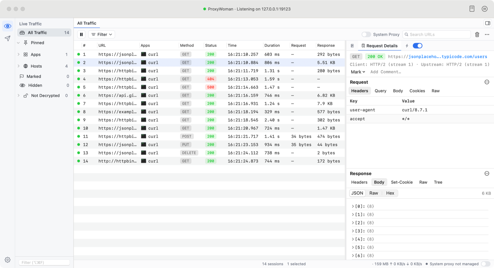
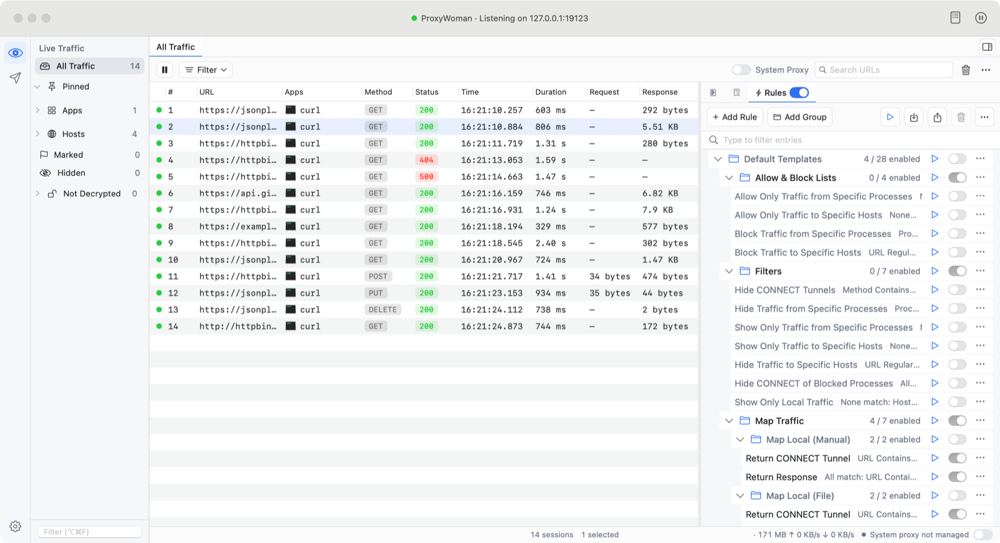
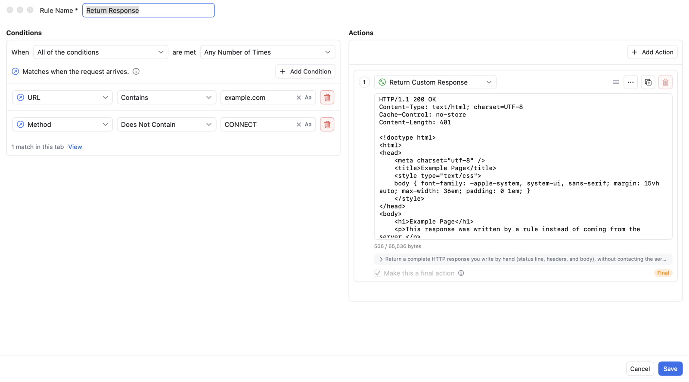
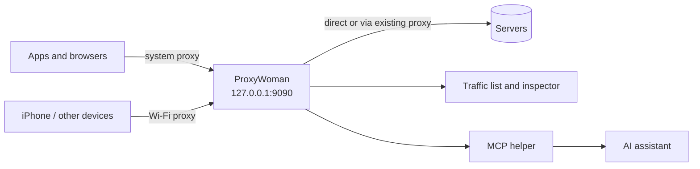

<p align="center">
  <b>English</b> · <a href="README.zh-CN.md">简体中文</a>
</p>

<p align="center">
  
</p>

<h1 align="center">ProxyWoman</h1>

<p align="center">
  <b>A free, open-source, native macOS HTTP/HTTPS debugging proxy.</b><br>
  Capture, decrypt, inspect, mock and rewrite network traffic. Free forever, with no account and no paid tier.
</p>

<p align="center">
  <a href="https://github.com/gzldc/ProxyWoman/releases/latest"></a>
  <a href="https://github.com/gzldc/ProxyWoman/releases"></a>
  <a href="LICENSE"></a>
  
  
  
</p>

<p align="center">
  <a href="https://github.com/gzldc/ProxyWoman/releases/latest"><b>Download</b></a> ·
  <a href="#quick-start">Quick start</a> ·
  <a href="#features">Features</a> ·
  <a href="#comparison-with-other-tools">Comparison</a> ·
  <a href="#use-with-ai-assistants-mcp">MCP for AI</a> ·
  <a href="#faq">FAQ</a>
</p>

<p align="center">
  
</p>

---

## What is ProxyWoman?

ProxyWoman is a **man-in-the-middle debugging proxy for macOS**. It sits between your apps and the internet, records
every HTTP and HTTPS request and response, and lets you change them on the fly. Developers, QA engineers and
security researchers use this kind of tool to:

- see exactly which API calls an app, a website or a command-line tool makes;
- read encrypted HTTPS traffic in plain text;
- fake server responses to test edge cases without changing backend code;
- slow down, block or break requests to test error handling;
- replay and edit requests while debugging.

ProxyWoman does all of this in a **native Swift app** (SwiftUI, AppKit, SwiftNIO), with **no subscription, no license
key, no sign-in and no telemetry**. The source code is published under the Apache License 2.0.

It is an independent alternative to **Proxyman**, **Charles Proxy**, **Fiddler Everywhere**, **HTTP Toolkit** and
**mitmproxy**. It is not affiliated with any of them.

## Why ProxyWoman

| | |
|---|---|
| 💸 **Completely free** | Every feature is free for personal and commercial use. No trial, no "Pro" tier, no limit on rules, breakpoints or sessions. |
| 🔓 **Open source** | Apache License 2.0. You can read, audit, build and modify all of the code. |
| 🍎 **Native macOS** | Written in Swift with SwiftUI and AppKit. Not Electron, not Java. Separate builds for Apple silicon and Intel. |
| 🙈 **Private by default** | No account, no analytics, no cloud. Captured traffic never leaves your Mac. |
| 🤖 **AI-ready** | A built-in MCP (Model Context Protocol) server lets Claude, Cursor and other AI assistants read and analyse your traffic, with sensitive values redacted by default. |
| 🛟 **Safe system proxy** | Backs up and restores your proxy settings, even after a crash, and chains to an existing proxy such as Clash so your network keeps working. |
| 🌏 **Bilingual** | Full English and Simplified Chinese interfaces, switchable in the app. |

## Contents

- [What is ProxyWoman?](#what-is-proxywoman)
- [Why ProxyWoman](#why-proxywoman)
- [Screenshots](#screenshots)
- [Comparison with other tools](#comparison-with-other-tools)
- [Install](#install)
- [Quick start](#quick-start)
- [Features](#features)
- [Common tasks (how-to)](#common-tasks-how-to)
- [Use with AI assistants (MCP)](#use-with-ai-assistants-mcp)
- [Command-line tools such as curl](#command-line-tools-such-as-curl)
- [Settings](#settings)
- [How it works](#how-it-works)
- [FAQ](#faq)
- [Build from source](#build-from-source)
- [Limitations and roadmap](#limitations-and-roadmap)
- [Security](#security)
- [Uninstall](#uninstall)
- [Contributing](#contributing)
- [License](#license)
- [Changelog](CHANGELOG.md)

## Screenshots

**Traffic list and details.** Every request with its app, method, status, timing and size; headers, cookies,
query, raw message and a JSON viewer for the selected session.


**Rules.** Grouped rules with on/off switches and a built-in library of default templates.



**Rule editor.** Field-specific conditions on the left and an ordered list of actions on the right, with a live
count of how many captured sessions match.



## Comparison with other tools

| | **ProxyWoman** | Proxyman | Charles Proxy | Fiddler Everywhere | HTTP Toolkit | mitmproxy |
|---|---|---|---|---|---|---|
| Price | **Free, all features** | Free tier + paid license | Paid license (trial) | Paid subscription | Free tier + paid Pro | Free |
| Open source | **Yes (Apache-2.0)** | No | No | No | Yes (AGPL-3.0) | Yes (MIT) |
| Account required | **No** | No | No | Yes | Only for Pro | No |
| Technology | **Native Swift (SwiftUI/AppKit)** | Native Swift | Java | Electron | Electron | Python (CLI / web UI) |
| Platforms | macOS | macOS, Windows, Linux | macOS, Windows, Linux | macOS, Windows, Linux | macOS, Windows, Linux | macOS, Windows, Linux |
| Graphical desktop app | **Yes** | Yes | Yes | Yes | Yes | No (terminal / browser UI) |
| HTTPS decryption | **Yes** | Yes | Yes | Yes | Yes | Yes |
| HTTP/2 | **Yes** | Yes | Yes | Yes | Yes | Yes |
| WebSocket | **Yes** | Yes | Yes | Yes | Yes | Yes |
| Rules (rewrite, Map Local, mock) | **Yes, unlimited** | Yes | Yes | Yes | Yes (some in Pro) | Via scripts |
| Breakpoints | **Yes** | Yes | Yes | Yes | Yes | Yes (intercept) |
| Compose / repeat requests | **Yes** | Yes | Yes | Yes | Yes (Pro) | Replay |
| Open HAR files / saved sessions | **Yes** | Yes | Yes | Yes | Yes | Yes |
| Built-in MCP server for AI | **Yes** | — | — | — | — | — |
| Chinese interface | **Yes** | — | — | — | — | — |
| Telemetry | **None** | — | — | — | — | — |

"—" means not checked or not applicable. The other columns are based on each vendor's public information as of
October 2026 and may change; check their websites for current details. Corrections are welcome as issues or
pull requests.

**In short:** if you work on a Mac and want a native, polished debugging proxy that costs nothing, needs no account,
keeps everything local and can be read by your AI assistant, ProxyWoman is built for you. If you need Windows or
Linux, or scripted automation in Python, the tools above may suit you better.

## Install

1. Download the DMG for your Mac from the [latest release](https://github.com/gzldc/ProxyWoman/releases/latest),
   together with its `.sha256` file:

   | Your Mac | File |
   |---|---|
   | Apple silicon (M1, M2, M3, M4 and later) | `ProxyWoman-<version>-arm.dmg` |
   | Intel | `ProxyWoman-<version>-intel.dmg` |

   To see which chip you have, open  ▸ **About This Mac**.
2. Check the download. In the download folder, run
   `shasum -a 256 -c ProxyWoman-<version>-<arm|intel>.dmg.sha256`; it should print `OK`.
3. Open the DMG and drag **ProxyWoman** onto **Applications**.
4. First launch: the app is ad-hoc signed. It is **not signed with an Apple Developer ID and not notarized**, so
   macOS blocks it the first time. Open **System Settings ▸ Privacy & Security** and click **Open Anyway**, or run
   `xattr -dr com.apple.quarantine /Applications/ProxyWoman.app`. Only do this for a download from this
   repository's Releases page whose checksum matches.

Requirements: macOS 14 Sonoma or later. The download is about 15 MB.

## Quick start

1. **Launch ProxyWoman.** The proxy listens on `127.0.0.1:9090`, or on the next free port up to 9099 if 9090 is
   busy. The title bar shows the address. The app also adds a menu bar icon.
2. **Turn on the system proxy.** Use the **System Proxy** switch at the bottom-right corner of the window, the
   switch in the toolbar next to the search field, or the menu bar icon. Every network service's HTTP and HTTPS
   proxy then points at ProxyWoman. Turning it off, or quitting the app, restores your previous settings.
3. **Trust the root certificate to see HTTPS contents.** Choose **Certificate ▸ Install Certificate on This
   Mac…** and follow the steps; macOS asks for your password. Until the root is trusted, HTTPS sites that
   ProxyWoman decrypts show certificate errors, so ProxyWoman asks before enabling the system proxy.
4. **Browse or run your app.** Requests appear in the traffic list as they happen. Select one to see its
   details.

## Features

### Capture

- HTTP/1.1, HTTP/2 and HTTPS (TLS interception with a locally generated root certificate).
- WebSocket connections and messages.
- Traffic from any app that uses the macOS system proxy: browsers, native apps, the iOS Simulator, and
  command-line tools configured with `HTTP_PROXY` / `HTTPS_PROXY`.
- Traffic from iPhone, iPad, Android and other devices on the same network: turn on **Allow devices on the local
  network** and the app shows the address to enter on the phone, plus a QR code for the certificate download.
- iOS Simulator in one click: **Certificate ▸ Install Certificate on iOS Simulator** adds the root certificate to
  every running simulator; simulators use the Mac's proxy, so turn on **System Proxy** and their traffic appears.
- Per-app attribution: each session shows the name and icon of the process that made it.
- Pause and resume capture; auto-select the newest session.
- Upstream chaining: if a proxy such as Clash is already configured, ProxyWoman forwards through it.

### Traffic list

- Columns: number, URL, app, method, status, time, duration, request size, response size and SSL state.
- A source sidebar: **All Traffic**, **Pinned**, **Apps**, **Hosts**, **Marked**, **Hidden** and **Not Decrypted**.
- Search URLs; filter by method, status, content type and more.
- Pin apps and hosts; mark sessions with colours and text; add comments; hide noisy sessions.
- Detail panel on the right or below the list.
- A status bar with the session count, memory use, upload and download rates, and the system proxy switch.

### Request and response inspector

- Overview with method, status, URL, and client and upstream protocol (for example HTTP/2 stream numbers).
- Request tabs: Headers, Query, Body, Cookies and Raw.
- Response tabs: Headers, Body, Set-Cookie, Raw and Tree.
- Body viewers: JSON (tree and text), images, hex dump and plain text.
- JWT tab: tokens in headers, cookies and the query string are decoded automatically (header, payload,
  issued and expiry times, expired or not). Read-only; the signature is not verified.
- Automatic decoding of gzip, deflate and Brotli bodies.
- TLS and certificate details for HTTPS connections.
- WebSocket message list with direction, type, size and time, exportable as JSONL, raw text or HAR.
- Copy as cURL; export one or more sessions as HAR.
- **File ▸ Open HAR / Session… (⌘O)** opens HAR files saved by ProxyWoman, Chrome/Safari DevTools, Charles,
  Proxyman and other tools, so a saved session can be reopened and inspected later.

### Rules: modify traffic automatically

Rules are listed in the **Rules** panel and edited in the rule editor. They can be grouped, ordered, enabled,
disabled, duplicated and imported. All rules can be paused at once.

**Conditions** can require all, any or none of them to match, with an optional limit on how many times a rule fires:

| Group | Fields |
|---|---|
| Request | URL, host, path, scheme, method, request headers, request cookies, request body, request body size, client HTTP version, client IP, process (app), request date and time |
| Response | Status code, response headers, response cookies, response body, response body size, duration, remote IP, remote HTTP version, protocol (HTTP, WebSocket, RPC, gRPC, server-sent events, Socket.IO), TLS certificate details |
| Other | All sessions, comment, session state and other session-wide fields |

Each field has its own operators and value controls: contains, equals, starts with, ends with, regular
expression, exists, greater than, less than, before, after, is empty, and their negations, with optional case
sensitivity. The editor shows live how many of the captured sessions match.

**Actions** run in order, and a rule can have several:

| Category | Actions |
|---|---|
| Headers and cookies | Set, add, replace, remove, or find and replace request and response headers and cookies |
| Content | Modify request or response body, URL, query parameters or status code |
| Responses | Return a predefined response (404, 500, redirects and more), a hand-written response, or a local file (Map Local) |
| Network | Delay the request; close the connection gracefully or abruptly; return a CONNECT tunnel |
| Debugging | Set a request or response breakpoint |
| Organising | Mark with colour and text, add a comment, hide the session, skip HTTPS decryption |
| Flow | Make an action final so later rules are not processed |

**Default templates.** A disabled **Default Templates** group ships with ready-made rules: allow and block lists
by app or host, hiding CONNECT tunnels, Map Local and Map Remote, 307 redirects, bypassing CORS, disabling the
cache, blocking cookies, setting a User-Agent, marking scripts and JSON, and more. Enable or copy one as a
starting point.

If a rule is enabled but its group is turned off, the rule list shows a warning that the rule has no effect.

### Breakpoints

Pause a matching request before it is sent, or a response before it reaches the app. Edit the method, URL,
headers and body, then continue or abort. The Breakpoints window lists everything that is paused.

### Compose and repeat

Build a request from scratch or from a captured session, edit it, send it and inspect the response. Save drafts.
Repeat a request with a configurable count, concurrency and interval, optionally applying your rules.

### Traffic tools

- **No Caching**: strip cache headers so every request reaches the server.
- **Allow List** and **Block List**: record or block only the hosts you choose.
- **Network Conditions**: simulate slow or unreliable networks.
- **SSL Proxying List**: choose which hosts are decrypted. Hosts with certificate pinning are passed through
  automatically.

### System proxy, recovery and upstream proxies

- ProxyWoman backs up your proxy settings before changing them. If the app crashes or is killed, the next
  launch restores them. It only restores settings that still point at ProxyWoman, so anything another tool
  changed in the meantime is left alone.
- If a proxy was already configured (for example Clash on `127.0.0.1:7897`), ProxyWoman uses it as its upstream.
  Traffic leaves through that proxy's CONNECT tunnel and its bypass list still applies.
- Upstream proxy: follow the original system proxy (default), enter a proxy manually with its own bypass list,
  or connect directly.
- **Bypass Proxy Settings**: hosts added to the system's bypass list while ProxyWoman manages it, so apps reach
  them without going through ProxyWoman. The original list comes back when you turn the system proxy off.
- Optionally take over the system proxy and start capturing automatically at launch.
- Copy a ready-made `export http_proxy=…` command for the current terminal.

## Common tasks (how-to)

| I want to… | How |
|---|---|
| See the API calls a Mac app makes | Turn on **System Proxy**, use the app, then pick it under **Apps** in the sidebar. |
| Read HTTPS bodies | Install and trust the root certificate (**Certificate ▸ Install Certificate on This Mac…**). |
| Return fake JSON for an endpoint | Create a rule with the condition **URL contains** `/api/x` and the action **Return Custom Response** or **Map Local**. |
| Point production at staging | A rule that modifies the URL (Map Remote), or the 307 redirect template. |
| Test slow networks | **Tools ▸ Network Conditions**, or a rule with a delay action. |
| Edit a request before it is sent | A rule with a request breakpoint action, then edit and continue in the Breakpoints window. |
| Hide noise such as analytics hosts | Hide the session, or use the **Hide Traffic to Specific Hosts** template. |
| Share a request with a teammate | **Copy as cURL**, or **Export HAR…**. |
| Debug an iPhone or Android app | **Certificate ▸ Install Certificate on iPhone / Android…**, turn on **Allow devices on the local network**, then follow the steps shown (Wi-Fi proxy, certificate download, trust). |
| Debug an app in the iOS Simulator | Boot the simulator, choose **Certificate ▸ Install Certificate on iOS Simulator**, then turn on **System Proxy**. |
| Reopen a saved capture or a HAR from another tool | **File ▸ Open HAR / Session… (⌘O)**. Save the current capture with **Export HAR…**. |
| Inspect a JWT | Select the request and open the **JWT** tab: header, payload and expiry are decoded automatically. |
| Ask an AI about failing requests | Enable the MCP server in **Settings ▸ MCP (AI Integration)** and connect your AI client. |

## Use with AI assistants (MCP)

ProxyWoman includes an MCP (Model Context Protocol) server, so AI assistants such as Claude Desktop, Claude Code
and Cursor can read your captured traffic.

- Enable it in **Settings ▸ MCP (AI Integration)**. It is off by default.
- The settings page shows ready-to-paste configuration for each client. The configuration runs the helper
  `ProxyWoman.app/Contents/MacOS/proxywoman-mcp`, which talks to the running app over a local socket that only
  your user account can access. No network port is opened.
- Read-only tools: `get_status`, `list_flows`, `search_flows`, `get_flow`, `list_rules`, `export_flow_curl`,
  `export_har`.
- Write tools are off by default and must each be allowed explicitly: `create_rule`, `update_rule`,
  `set_rule_enabled`, `set_recording`. Rules created by AI are always saved disabled.
- Sensitive values such as authorization headers, cookies and tokens are redacted by default before they reach
  the AI client.

Example prompts:

- "Which requests to api.example.com failed in the last minute, and why?"
- "Explain this JSON response and point out unusual fields."
- "Create a rule that returns HTTP 500 for /checkout so I can test the error screen."

## Command-line tools such as curl

curl does not read the system proxy or the keychain. Point it at the proxy and the root certificate explicitly:

```sh
curl -x http://127.0.0.1:9090 \
  --cacert "$HOME/Library/Application Support/ProxyWoman/CA/root-ca.pem" \
  https://example.com/
```

Many other tools accept `HTTP_PROXY=http://127.0.0.1:9090` and `HTTPS_PROXY=http://127.0.0.1:9090` together
with the same certificate. **Settings ▸ Advanced** can copy the export command for you.

## Settings

| Page | What it controls |
|---|---|
| General | Interface language, layout, menu bar icon, port, system proxy and capture at launch, HTTP/2, quit confirmation, root certificate |
| Appearance | Theme, font, time format, zebra rows, text wrapping |
| HTTPS | SSL proxying list (which hosts are decrypted), pass-through hosts, undecrypted sessions |
| Traffic Control | Allow and block lists, network conditions |
| Privacy | What the app does and does not collect (no analytics) |
| Tools | Copy formats such as cURL |
| MCP (AI Integration) | MCP server, client configuration, write permissions, redaction |
| Advanced | System proxy setup and restore, automatic deletion of old sessions, terminal proxy command |

### Interface language

The interface is available in English and Simplified Chinese. Choose **Follow System** (the default), **English**
or **简体中文** in **Settings ▸ General ▸ Language**. The change applies after the app restarts. The prompt offers
**Restart Now**, and the system proxy stays as it was across the restart. With Follow System, only the first
language in the macOS preferred list counts: Chinese gives Simplified Chinese, English gives English, and any
other language gives Simplified Chinese.

## How it works



1. ProxyWoman runs a local HTTP proxy built on SwiftNIO.
2. For HTTPS, the client sends `CONNECT host:443`. ProxyWoman answers with a certificate for that host, signed on
   the fly by a root certificate generated on your Mac, so it can read the request and response.
3. Rules and breakpoints run on each request and response, in order.
4. The request goes to the server directly, or through your existing proxy.
5. Each session is stored in memory, with large bodies spooled to disk, and shown in the UI.

## FAQ

**Is ProxyWoman really free?** Yes. Every feature is free for personal and commercial use under the Apache
License 2.0. There is no paid tier, no trial, no account and no analytics.

**Is it a Proxyman clone?** It is an independent, open-source project covering the same core workflow. It shares
no code with Proxyman, Charles or Fiddler and is not affiliated with them.

**What is a good free alternative to Proxyman or Charles on Mac?** ProxyWoman is free with every feature unlocked:
HTTPS decryption, unlimited rules, Map Local, Map Remote, breakpoints, Compose, HAR import and export, phone and
iOS Simulator capture, and a built-in MCP server. It is open source (Apache-2.0) and needs no account. See the
[comparison](#comparison-with-other-tools).

**How is it different from Wireshark?** Wireshark records raw network packets, and HTTPS stays encrypted unless you
supply session keys. ProxyWoman works at the HTTP level: it decrypts HTTPS as a proxy, shows each request and
response with headers and bodies, and can change them with rules and breakpoints.

**How do I see the HTTPS requests a Mac app makes?** Trust the root certificate (**Certificate ▸ Install
Certificate on This Mac…**), turn on **System Proxy** and use the app. Its requests appear under **Apps** in the
sidebar. Apps that pin certificates are passed through without decryption.

**Is it safe to install the root certificate?** The root certificate is generated on your Mac and never uploaded.
Its private key stays in your user folder (see [Security](#security)). Remove the trust when you no longer need it:
**Certificate ▸ Remove Trust…**.

**Can I open a HAR file exported from Chrome DevTools?** Yes. In DevTools choose **Export HAR**, then open the file
with **File ▸ Open HAR / Session… (⌘O)**. HAR files from Safari, Firefox, Charles and Proxyman work too.

**How do I decode a JWT?** Select a request that carries one (in the `Authorization` header, a cookie or the URL)
and open the **JWT** tab. The header, payload and expiry are decoded locally; the signature is not verified.

**Does it work on Apple silicon and Intel Macs?** Yes. Download `-arm` for Apple silicon or `-intel` for Intel.

**Which macOS versions are supported?** macOS 14 Sonoma and later.

**Why does macOS say the app can't be verified?** The app is not notarized by Apple. See step 4 of
[Install](#install).

**Why do HTTPS sites show certificate errors?** Either the ProxyWoman root certificate is not trusted yet, or the
site pins its certificate. Install and trust the certificate, or pass the host through without decryption.

**Will I lose internet access while capturing?** No. If you already use a proxy such as Clash, ProxyWoman chains
to it. When you turn the system proxy off or quit, your original settings come back, even after a crash.

**Can I capture iPhone or Android traffic?** Yes. Choose **Certificate ▸ Install Certificate on iPhone / Android…**
and turn on **Allow devices on the local network**. Set the phone's Wi-Fi HTTP proxy to the address shown, open
`http://proxywoman.cert` (or scan the QR code) in the phone's browser to download the root certificate, then install
and trust it. On iPhone, turn on full trust in Settings ▸ General ▸ About ▸ Certificate Trust Settings. On Android 7
and later, apps only trust user certificates if they opt in. For the iOS Simulator, start the simulator and choose
**Certificate ▸ Install Certificate on iOS Simulator**: it installs the root certificate into every running simulator
(`xcrun simctl keychain`), and the simulator then uses the Mac's system proxy.

**Can I use a different upstream proxy, or none?** Yes: **Tools ▸ Advanced Proxy Settings… ▸ Upstream Proxy
Settings…** offers the original system proxy, a manual HTTP proxy, or a direct connection.

**How do I get a new root certificate?** Remove the trust of the current one (**Certificate ▸ Remove Trust…**), then
**Settings ▸ General ▸ Regenerate…**. ProxyWoman restarts with a new root, which you then install again.

**Can I capture apps that ignore the system proxy?** Not yet: there is no transparent proxy (Network Extension)
mode. Configure such apps to use `127.0.0.1:9090` directly.

**Does ProxyWoman upload my traffic?** No. Captured sessions stay on your Mac. The MCP server only answers the AI
client you configure and redacts sensitive values by default.

**Can I save a capture session to a file?** Yes. **Export HAR…** (⇧⌘E) saves the visible sessions, and
**Open HAR / Session…** (⌘O) opens them again, together with HAR files from other tools.

**How do I report a bug or request a feature?** Open an issue on
[GitHub](https://github.com/gzldc/ProxyWoman/issues).

## Build from source

Requires macOS 14+ to run, and Swift 6.2 (Xcode 26+) to build.

```sh
git clone https://github.com/gzldc/ProxyWoman.git
cd ProxyWoman
swift build                    # build
swift test                     # run the tests
scripts/test-all.sh            # run each test target on its own (the reliable way for release checks)
scripts/build-app.sh debug     # package build/ProxyWoman.app for this Mac's architecture (fast)
scripts/build-app.sh           # package a universal release app into build/
scripts/make-dmg.sh            # build release DMGs for arm64 and x86_64 into dist/
```

The project is a single Swift package:

| Module | Purpose |
|---|---|
| `App` | SwiftUI and AppKit macOS app |
| `Packages/ProxyCore` | SwiftNIO proxy engine: HTTP/1.1, HTTP/2, TLS interception, WebSocket, upstream chaining |
| `Packages/RulesEngine` | Rule model, matching and actions |
| `Packages/FlowStore` | In-memory session storage with on-disk body spooling |
| `Packages/AppCore` | View models and app logic, independent of the network engine |
| `Packages/Viewers` | Body and message viewers |
| `Packages/MCPKit`, `Packages/MCPWire` | MCP server and its `proxywoman-mcp` helper |
| `Packages/Localization` | English and Simplified Chinese strings |

## Limitations and roadmap

Current limitations:

- Upstream chaining supports plain HTTP CONNECT proxies only: no SOCKS upstream and no upstream authentication.
- Captured sessions live in memory: at most 100,000 sessions and 2 GB of bodies on disk, and the oldest are
  dropped first. Each body is recorded up to 50 MB.
- No transparent proxy (Network Extension) yet, so apps that ignore the system proxy are not captured.
- Per-app attribution names the process that opened the connection. For Safari that is
  `com.apple.WebKit.Networking`.
- The app is not notarized and does not update itself yet. Download new versions from Releases.

Planned: notarized builds with automatic updates, SOCKS and authenticated upstream proxies, scripting,
Protobuf preview, importing Charles sessions, and a transparent proxy mode.

## Security

The root certificate's private key is stored at
`~/Library/Application Support/ProxyWoman/CA/root-ca-key.pem` with `0600` permissions. Anyone who
obtains this file can intercept your HTTPS traffic while the root is trusted, so never share it.

To report a security issue, open a GitHub issue without exploit details and ask for a private contact.

## Uninstall

1. Turn off **System Proxy** and quit ProxyWoman. This restores your proxy settings.
2. Open **Keychain Access**, find **ProxyWoman CA (…)** in the login keychain and delete it.
3. Delete `/Applications/ProxyWoman.app` and `~/Library/Application Support/ProxyWoman`.

## Contributing

Issues and pull requests are welcome: bug reports, translations, documentation and code. Please run `swift test`
before opening a pull request. If ProxyWoman is useful to you, a ⭐ on GitHub helps other people find it.

## License

Apache License 2.0. See [LICENSE](LICENSE) and [NOTICE](NOTICE).

<sub>Keywords: macOS HTTP proxy, HTTPS debugging proxy, Mac network debugger, web debugging proxy, API debugging tool,
traffic inspector, packet capture for Mac, man-in-the-middle proxy, SSL proxying, TLS interception, Map Local,
Map Remote, breakpoint, mock API, rewrite response, HAR export, WebSocket debugger, HTTP/2, SwiftNIO, MCP server,
AI traffic analysis, free Proxyman alternative, free Charles Proxy alternative, Fiddler alternative for Mac,
HTTP Toolkit alternative, mitmproxy GUI alternative, open-source Proxyman, JWT decoder, HAR viewer, HAR import, iOS Simulator proxy, iPhone traffic capture,
Android HTTPS capture, 抓包工具, Mac 抓包, 手机抓包, JWT 解析.</sub>
