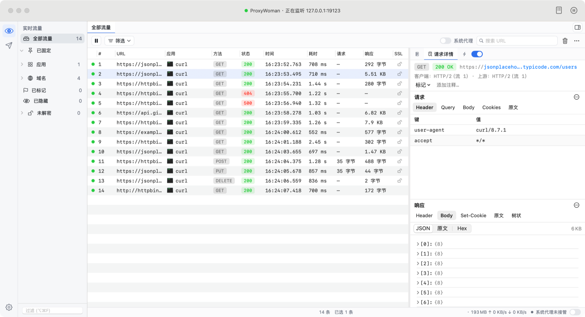
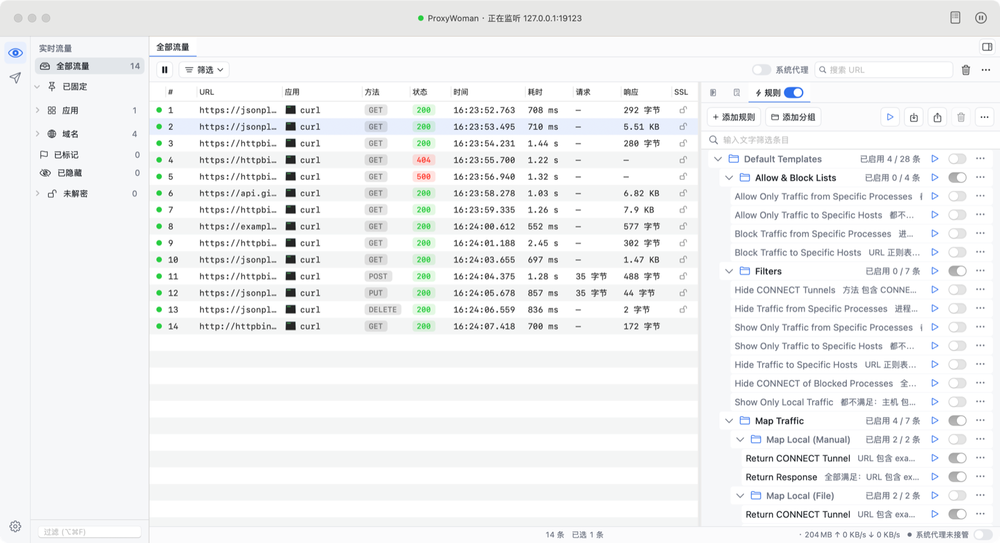
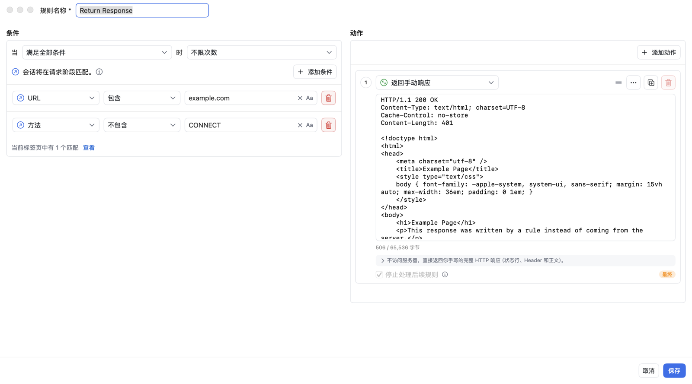
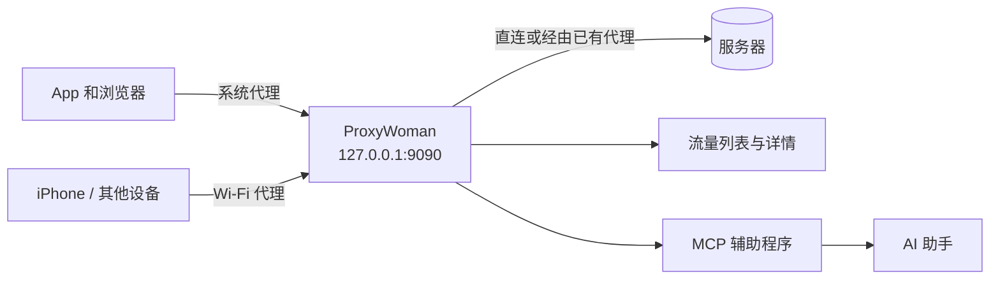

<p align="center">
  <a href="README.md">English</a> · <b>简体中文</b>
</p>

<p align="center">
  
</p>

<h1 align="center">ProxyWoman</h1>

<p align="center">
  <b>免费、开源的 macOS 原生 HTTP/HTTPS 抓包调试工具。</b><br>
  抓包、解密、查看、Mock、改写网络请求。永久免费，无需注册，没有付费版。
</p>

<p align="center">
  <a href="https://github.com/gzldc/ProxyWoman/releases/latest"></a>
  <a href="https://github.com/gzldc/ProxyWoman/releases"></a>
  <a href="LICENSE"></a>
  
  
  
</p>

<p align="center">
  <a href="https://github.com/gzldc/ProxyWoman/releases/latest"><b>下载</b></a> ·
  <a href="#快速上手">快速上手</a> ·
  <a href="#功能详解">功能</a> ·
  <a href="#与同类工具对比">对比</a> ·
  <a href="#配合-ai-助手使用mcp">AI 接入</a> ·
  <a href="#常见问题">常见问题</a>
</p>

<p align="center">
  
</p>

---

## ProxyWoman 是什么？

ProxyWoman 是一款 **macOS 上的中间人（MITM）抓包调试代理**。它位于你的 App 和互联网之间，记录每一个 HTTP 和
HTTPS 请求与响应，并且可以实时修改它们。开发、测试和安全研究人员用这类工具来：

- 查看某个 App、网页或命令行工具到底调用了哪些接口；
- 以明文查看加密的 HTTPS 流量；
- 不改后端代码，伪造服务器响应来测试各种边界情况；
- 让请求变慢、被拦截或失败，测试错误处理；
- 调试时重放、修改请求。

ProxyWoman 以 **Swift 原生 App**（SwiftUI、AppKit、SwiftNIO）实现以上全部功能，**不订阅、不要激活码、不用登录、
不上报任何数据**，源代码基于 Apache License 2.0 公开。

它可以作为 **Proxyman**、**Charles**、**Fiddler Everywhere**、**HTTP Toolkit**、**mitmproxy** 的独立替代品，
与以上任何产品均无关联。

## 为什么选 ProxyWoman

| | |
|---|---|
| 💸 **完全免费** | 所有功能对个人和商业使用都免费。没有试用期、没有"专业版"，规则、断点、会话数量都不限制。 |
| 🔓 **开源** | Apache License 2.0，全部代码都可以阅读、审计、自行编译和修改。 |
| 🍎 **macOS 原生** | Swift + SwiftUI + AppKit 编写，不是 Electron，也不是 Java。Apple 芯片和 Intel 分别提供安装包。 |
| 🙈 **默认保护隐私** | 不需要账号，没有统计，没有云端。抓到的数据不会离开你的 Mac。 |
| 🤖 **为 AI 准备** | 内置 MCP（Model Context Protocol）服务，Claude、Cursor 等 AI 助手可以直接读取和分析流量，敏感信息默认脱敏。 |
| 🛟 **系统代理安全可靠** | 自动备份和恢复代理设置，崩溃后也能恢复；可串联 Clash 等已有代理，抓包时不断网。 |
| 🌏 **中英双语** | 完整的简体中文和英文界面，可在 App 内切换。 |

## 目录

- [ProxyWoman 是什么？](#proxywoman-是什么)
- [为什么选 ProxyWoman](#为什么选-proxywoman)
- [截图](#截图)
- [与同类工具对比](#与同类工具对比)
- [安装](#安装)
- [快速上手](#快速上手)
- [功能详解](#功能详解)
- [常见用法](#常见用法)
- [配合 AI 助手使用（MCP）](#配合-ai-助手使用mcp)
- [curl 等命令行工具](#curl-等命令行工具)
- [设置](#设置)
- [工作原理](#工作原理)
- [常见问题](#常见问题)
- [从源码构建](#从源码构建)
- [已知限制与路线图](#已知限制与路线图)
- [安全说明](#安全说明)
- [卸载](#卸载)
- [参与贡献](#参与贡献)
- [许可证](#许可证)

## 截图

**流量列表与详情。** 每个请求的 App、方法、状态码、耗时和大小一目了然；选中后可查看请求头、Cookie、查询参数、
原始报文，以及 JSON 查看器。


**规则。** 规则可分组、一键开关，并内置一套默认模板。



**规则编辑器。** 左侧是按字段区分的条件，右侧是按顺序执行的动作，并实时显示已抓到的会话中有多少条匹配。



## 与同类工具对比

| | **ProxyWoman** | Proxyman | Charles | Fiddler Everywhere | HTTP Toolkit | mitmproxy |
|---|---|---|---|---|---|---|
| 价格 | **免费，全部功能** | 免费版 + 付费授权 | 付费授权（可试用） | 付费订阅 | 免费版 + 付费 Pro | 免费 |
| 开源 | **是（Apache-2.0）** | 否 | 否 | 否 | 是（AGPL-3.0） | 是（MIT） |
| 需要注册账号 | **否** | 否 | 否 | 是 | 仅 Pro 需要 | 否 |
| 技术栈 | **Swift 原生（SwiftUI/AppKit）** | Swift 原生 | Java | Electron | Electron | Python（命令行 / 网页界面） |
| 平台 | macOS | macOS、Windows、Linux | macOS、Windows、Linux | macOS、Windows、Linux | macOS、Windows、Linux | macOS、Windows、Linux |
| 图形桌面 App | **是** | 是 | 是 | 是 | 是 | 否（终端 / 浏览器界面） |
| HTTPS 解密 | **支持** | 支持 | 支持 | 支持 | 支持 | 支持 |
| HTTP/2 | **支持** | 支持 | 支持 | 支持 | 支持 | 支持 |
| WebSocket | **支持** | 支持 | 支持 | 支持 | 支持 | 支持 |
| 规则（改写、Map Local、Mock） | **支持，不限数量** | 支持 | 支持 | 支持 | 支持（部分需 Pro） | 需写脚本 |
| 断点 | **支持** | 支持 | 支持 | 支持 | 支持 | 支持（intercept） |
| Compose / 重复发送 | **支持** | 支持 | 支持 | 支持 | 支持（Pro） | 重放 |
| 内置 AI 用的 MCP 服务 | **支持** | — | — | — | — | — |
| 中文界面 | **支持** | — | — | — | — | — |
| 数据上报 | **无** | — | — | — | — | — |

"—" 表示未核实或不适用。其他各列依据各厂商截至 2026 年 10 月的公开信息整理，之后可能变化，请以其官网为准；
如有错误，欢迎提 Issue 或 PR 指正。

**一句话总结：** 如果你用 Mac，想要一款原生、好用、不花钱、不用注册、数据全在本地、还能让 AI 助手直接读取的抓包
工具，ProxyWoman 就是为你做的。如果你需要 Windows、Linux 或用 Python 脚本自动化，上面其他工具可能更合适。

## 安装

1. 在 [最新版本](https://github.com/gzldc/ProxyWoman/releases/latest) 页面下载对应芯片的 DMG 和同名的
   `.sha256` 文件：

   | 你的 Mac | 下载文件 |
   |---|---|
   | Apple 芯片（M1、M2、M3、M4 及更新） | `ProxyWoman-<版本>-arm.dmg` |
   | Intel 芯片 | `ProxyWoman-<版本>-intel.dmg` |

   不确定是哪种芯片，可以打开  ▸ **关于本机** 查看。
2. 校验下载文件：在下载目录运行 `shasum -a 256 -c ProxyWoman-<版本>-<arm|intel>.dmg.sha256`，输出 `OK` 即可。
3. 打开 DMG，把 **ProxyWoman** 拖到 **应用程序** 文件夹。
4. 首次打开：App 只做了临时（ad-hoc）签名，**没有 Apple 开发者 ID 签名，也没有经过公证**，所以第一次打开会被
   macOS 拦截。到 **系统设置 ▸ 隐私与安全性** 点击 **仍要打开**，或者运行
   `xattr -dr com.apple.quarantine /Applications/ProxyWoman.app`。请只对从本仓库 Releases 下载、且校验通过的
   文件这样做。

系统要求：macOS 14 Sonoma 及以上。安装包约 15 MB。

## 快速上手

1. **打开 ProxyWoman。** 代理监听 `127.0.0.1:9090`；如果 9090 被占用，会依次尝试到 9099。标题栏会显示监听地址，
   菜单栏也会出现图标。
2. **开启系统代理（接管系统流量）。** 点窗口 **右下角** 的 **系统代理** 开关；也可以用流量列表上方工具栏里、
   搜索框左边的同名开关，或者菜单栏图标。开启后，所有网络服务的 HTTP/HTTPS 代理都会指向 ProxyWoman；关闭开关或
   退出 App 时会恢复原来的设置。
3. **信任根证书以查看 HTTPS 内容。** 选择菜单 **证书 ▸ 在这台 Mac 上安装证书…**，按提示操作，macOS 会要求输入
   密码。根证书未被信任时，被解密的 HTTPS 网站会报证书错误，所以开启系统代理前 ProxyWoman 会先询问。
4. **正常浏览网页或运行你的 App。** 请求会实时出现在流量列表中，选中即可查看详情。

## 功能详解

### 抓包

- HTTP/1.1、HTTP/2 和 HTTPS（使用本机生成的根证书进行 TLS 解密）。
- WebSocket 连接与消息。
- 所有走 macOS 系统代理的流量：浏览器、原生 App、iOS 模拟器，以及设置了 `HTTP_PROXY` / `HTTPS_PROXY` 的命令行工具。
- 同一网络下 iPhone、iPad、安卓等设备的流量：打开 **允许局域网设备连接**，App 会显示手机上要填的代理地址，以及下载证书的二维码。
- 按 App 归类：每个会话都显示发出请求的进程名称和图标。
- 暂停 / 继续抓包；自动选中最新会话。
- 上游代理串联：已经配置了 Clash 等代理时，ProxyWoman 会经由它转发。

### 流量列表

- 列：序号、URL、App、方法、状态码、时间、耗时、请求大小、响应大小、SSL 状态。
- 左侧来源栏：**全部流量**、**已固定**、**应用**、**域名**、**已标记**、**已隐藏**、**未解密**。
- 搜索 URL；按方法、状态码、内容类型等筛选。
- 固定 App 和域名；用颜色和文字标记会话；添加备注；隐藏干扰会话。
- 详情面板可以放在右侧，也可以放在列表下方。
- 底部状态栏显示会话数量、内存占用、上下行速率和系统代理开关。

### 请求与响应详情

- 概览：方法、状态码、URL，以及客户端和上游协议（例如 HTTP/2 的 stream 编号）。
- 请求标签页：Header、Query、Body、Cookies、原文。
- 响应标签页：Header、Body、Set-Cookie、原文、树状。
- 内容查看器：JSON（树形和文本）、图片、十六进制、纯文本。
- 自动解码 gzip、deflate 和 Brotli。
- HTTPS 连接的 TLS 和证书信息。
- WebSocket 消息列表，显示方向、类型、大小和时间，可导出为 JSONL、原始文本或 HAR。
- 复制为 cURL；导出一个或多个会话为 HAR。
- **文件 ▸ 打开 HAR / 会话…（⌘O）** 可打开 ProxyWoman、Chrome/Safari 开发者工具、Charles、Proxyman 等导出的 HAR 文件，
  保存过的抓包会话可以随时重新打开查看。
- JWT 标签页：自动解码请求头、Cookie 和 URL 参数中的 JWT，显示 Header、Payload、签发和过期时间，以及是否已过期。
  只做解码查看，不校验签名。

### 规则：自动修改流量

规则在 **规则** 面板中列出，在规则编辑器中编辑，可以分组、排序、启用、停用、复制和导入，也可以一键暂停全部规则。

**条件**：可设置为全部满足、任一满足或全部不满足，并可限制规则最多触发几次。

| 分组 | 字段 |
|---|---|
| 请求 | URL、主机、路径、协议（scheme）、方法、请求头、请求 Cookie、请求体、请求体大小、客户端 HTTP 版本、客户端 IP、进程（App）、请求日期和时间 |
| 响应 | 状态码、响应头、响应 Cookie、响应体、响应体大小、耗时、远端 IP、远端 HTTP 版本、协议类型（HTTP、WebSocket、RPC、gRPC、SSE、Socket.IO）、TLS 证书信息 |
| 其他 | 所有会话、备注、会话状态等会话级字段 |

每个字段都有各自的运算符和输入控件：包含、等于、开头是、结尾是、正则表达式、存在、大于、小于、早于、晚于、为空，
以及它们的否定形式，可选区分大小写。编辑时会实时显示当前已抓到的会话中有多少条满足条件。

**动作**：一条规则可以有多个动作，按顺序执行。

| 类别 | 动作 |
|---|---|
| 请求头与 Cookie | 设置、添加、替换、删除、查找替换请求和响应的头与 Cookie |
| 内容 | 修改请求或响应的内容、URL、查询参数、状态码 |
| 响应 | 返回预设响应（404、500、重定向等）、手写响应或本地文件（Map Local） |
| 网络 | 延迟请求；正常或强制关闭连接；返回 CONNECT 隧道 |
| 调试 | 设置请求断点或响应断点 |
| 整理 | 用颜色和文字标记、添加备注、隐藏会话、跳过 HTTPS 解密 |
| 流程 | 设为最终动作，不再处理后续规则 |

**默认模板**：内置一个默认停用的 **默认模板** 分组，包含现成规则：按 App 或域名的白名单 / 黑名单、隐藏 CONNECT 隧道、
Map Local 与 Map Remote、307 重定向、绕过 CORS、禁用缓存、屏蔽 Cookie、设置 User-Agent、标记脚本和 JSON 等。
可以直接启用，也可以复制后修改。

### 断点

在匹配的请求发出前、或响应返回给 App 前暂停。可以编辑方法、URL、头和内容，然后放行或中止。断点窗口会列出所有
暂停中的请求。

### Compose 与重复发送

从零构造请求，或基于已抓到的会话修改后发送并查看响应，支持保存草稿。可以按设定的次数、并发数和间隔重复发送，
并可选择是否应用规则。

### 流量工具

- **禁用缓存**：去掉缓存相关的头，让每个请求都真正到达服务器。
- **允许列表** 和 **屏蔽列表**：只记录或只屏蔽你指定的域名。
- **网络条件**：模拟慢速或不稳定的网络。
- **SSL 代理列表**：选择解密哪些域名；检测到证书锁定的域名会自动改为直通。

### 系统代理、异常恢复与上游代理

- 修改系统代理前，ProxyWoman 会先备份原有设置。如果 App 崩溃或被强制退出，下次启动时会自动恢复。只恢复仍然指向
  ProxyWoman 的设置，期间被其他工具改过的设置不会动。
- 如果原本已经配置了代理（例如 Clash 的 `127.0.0.1:7897`），ProxyWoman 会把它作为上游。流量经由该代理的
  CONNECT 隧道出去，原来的绕过列表依然生效。
- 上游代理：跟随原系统代理（默认），或手动填写代理及其不走代理的域名，或直连。
- **绕过代理设置**：把域名加入系统代理的忽略列表，App 访问它们时完全不经过 ProxyWoman；关闭系统代理时恢复原来的列表。
- 可选：启动时自动接管系统代理、自动开始抓包。
- 一键复制当前终端可用的 `export http_proxy=…` 命令。

## 常见用法

| 我想要… | 怎么做 |
|---|---|
| 看某个 Mac App 调了哪些接口 | 打开 **系统代理**，使用该 App，然后在左侧 **应用** 里选中它。 |
| 看 HTTPS 的内容 | 安装并信任根证书（**证书 ▸ 在这台 Mac 上安装证书…**）。 |
| 让某个接口返回假 JSON | 新建规则，条件为 **URL 包含** `/api/x`，动作选 **返回手动响应** 或 **Map Local**。 |
| 把线上地址指向测试环境 | 用修改 URL 的规则（Map Remote），或 307 重定向模板。 |
| 测试弱网 | **工具 ▸ 网络条件**，或者使用带延迟动作的规则。 |
| 请求发出前先改一下 | 用带请求断点动作的规则，然后在断点窗口编辑并放行。 |
| 隐藏统计上报等干扰请求 | 隐藏该会话，或使用 **Hide Traffic to Specific Hosts** 模板。 |
| 把请求发给同事 | **复制为 cURL**，或 **导出 HAR…**。 |
| 调试 iPhone / 安卓 App | **证书 ▸ 在 iPhone / 安卓手机上安装证书…**，打开 **允许局域网设备连接**，按界面上的步骤设置 Wi-Fi 代理、下载并信任证书。 |
| 让 AI 帮忙分析失败的请求 | 在 **设置 ▸ MCP（AI 接入）** 中开启 MCP 服务，并连接你的 AI 客户端。 |

## 配合 AI 助手使用（MCP）

ProxyWoman 内置 MCP（Model Context Protocol）服务，Claude Desktop、Claude Code、Cursor 等 AI 助手可以读取你
抓到的流量。

- 在 **设置 ▸ MCP（AI 接入）** 中开启，默认关闭。
- 设置页提供各客户端可直接粘贴的配置。配置会运行 `ProxyWoman.app/Contents/MacOS/proxywoman-mcp` 这个辅助程序，
  它通过只有当前用户能访问的本地 socket 与正在运行的 App 通信，不会开放任何网络端口。
- 只读工具：`get_status`、`list_flows`、`search_flows`、`get_flow`、`list_rules`、`export_flow_curl`、`export_har`。
- 写入工具默认关闭，需要逐个单独允许：`create_rule`、`update_rule`、`set_rule_enabled`、`set_recording`。
  AI 创建的规则一律以停用状态保存。
- Authorization 头、Cookie、Token 等敏感信息默认会在发给 AI 前脱敏。

示例提问：

- "最近一分钟里 api.example.com 有哪些请求失败了？原因是什么？"
- "解释一下这个 JSON 响应，指出不正常的字段。"
- "建一条规则，让 /checkout 返回 500，我要测试错误页面。"

## curl 等命令行工具

curl 不读取系统代理，也不读取钥匙串，需要显式指定代理和根证书：

```sh
curl -x http://127.0.0.1:9090 \
  --cacert "$HOME/Library/Application Support/ProxyWoman/CA/root-ca.pem" \
  https://example.com/
```

很多其他工具也支持 `HTTP_PROXY=http://127.0.0.1:9090` 和 `HTTPS_PROXY=http://127.0.0.1:9090`，同样需要指定该证书。
**设置 ▸ 高级** 中可以一键复制终端代理命令。

## 设置

| 页面 | 内容 |
|---|---|
| 通用 | 界面语言、布局、菜单栏图标、端口、启动时接管系统代理和自动抓包、HTTP/2、退出确认、根证书 |
| 外观 | 主题、字体、时间格式、斑马纹、文本换行 |
| HTTPS | SSL 代理列表（解密哪些域名）、直通域名、未解密会话 |
| 流量控制 | 允许列表和屏蔽列表、网络条件 |
| 隐私 | App 收集和不收集什么（没有任何统计） |
| 工具 | cURL 等复制格式 |
| MCP（AI 接入） | MCP 服务、客户端配置、写入权限、脱敏 |
| 高级 | 系统代理设置与恢复、自动删除旧会话、终端代理命令 |

### 界面语言

界面支持简体中文和英文。在 **设置 ▸ 通用 ▸ 界面语言** 中选择 **跟随系统**（默认）、**简体中文** 或 **English**，
重启 App 后生效。切换时会提示 **立即重启**，重启前后系统代理状态保持不变。选择"跟随系统"时，只看 macOS 首选语言
列表中的第一个：中文显示简体中文，英文显示英文，其他语言显示简体中文。

## 工作原理



1. ProxyWoman 在本机运行一个基于 SwiftNIO 的 HTTP 代理。
2. 对于 HTTPS，客户端发送 `CONNECT host:443`。ProxyWoman 用本机生成的根证书即时签发该域名的证书，从而读取请求和响应。
3. 每个请求和响应都会按顺序经过规则和断点。
4. 请求直连服务器，或经由你原有的代理转发。
5. 每个会话保存在内存中，大的内容写入磁盘，并显示在界面上。

## 常见问题

**ProxyWoman 真的免费吗？** 是的。基于 Apache License 2.0，所有功能对个人和商业使用都免费，没有付费版、试用期、
账号和统计上报。

**它是 Proxyman 的克隆吗？** 它是独立的开源项目，覆盖同样的核心流程，与 Proxyman、Charles、Fiddler 没有任何代码
共享和关联。

**支持 Apple 芯片和 Intel 吗？** 都支持，分别下载 `-arm`（Apple 芯片）和 `-intel`（Intel）的 DMG。

**支持哪些 macOS 版本？** macOS 14 Sonoma 及以上。

**为什么 macOS 提示无法验证开发者？** 因为 App 没有经过 Apple 公证，见 [安装](#安装) 第 4 步。

**为什么 HTTPS 网站报证书错误？** 要么还没信任 ProxyWoman 的根证书，要么该网站做了证书锁定。请安装并信任证书，
或把该域名设为直通、不解密。

**抓包时会断网吗？** 不会。如果你在用 Clash 等代理，ProxyWoman 会串联它。关闭系统代理或退出 App 时，原来的设置
会恢复，崩溃后下次启动也会恢复。

**能抓 iPhone 或安卓手机的包吗？** 可以。选择 **证书 ▸ 在 iPhone / 安卓手机上安装证书…**，打开 **允许局域网设备连接**。
把手机 Wi-Fi 的 HTTP 代理设为界面显示的地址，用手机浏览器打开 `http://proxywoman.cert`（或扫二维码）下载根证书并安装。
iPhone 还需要到 设置 ▸ 通用 ▸ 关于本机 ▸ 证书信任设置 打开完全信任；Android 7 及以上的 App 默认不信任用户证书。
iOS 模拟器：先启动模拟器，再选择 **证书 ▸ 安装到 iOS 模拟器**，会把根证书装进所有正在运行的模拟器（`xcrun simctl keychain`），
模拟器使用 Mac 的系统代理。

**能换一个上游代理，或者不用上游吗？** 可以：**工具 ▸ 高级代理设置… ▸ 上游代理设置…** 中可选跟随原系统代理、手动设置
HTTP 代理或直连。

**怎么换一张新的根证书？** 先移除当前证书的信任（**证书 ▸ 移除信任…**），再到 **设置 ▸ 通用 ▸ 重新生成…**。
ProxyWoman 会重启并生成新的根证书，之后重新安装即可。

**不走系统代理的 App 能抓吗？** 暂时不能，目前没有透明代理（Network Extension）模式。可以让这类 App 直接使用
`127.0.0.1:9090` 作为代理。

**ProxyWoman 会上传我的流量吗？** 不会。抓到的数据只保存在本机。MCP 服务只响应你自己配置的 AI 客户端，并且默认
脱敏敏感信息。

**能把抓包会话保存成文件吗？** 可以。**导出 HAR…**（⇧⌘E）保存当前列表中的会话，**打开 HAR / 会话…**（⌘O）可以重新打开，
也能打开其他工具导出的 HAR 文件。

**怎么反馈问题或提需求？** 到 [GitHub Issues](https://github.com/gzldc/ProxyWoman/issues) 提交。

## 从源码构建

运行需要 macOS 14+，构建需要 Swift 6.2（Xcode 26+）。

```sh
git clone https://github.com/gzldc/ProxyWoman.git
cd ProxyWoman
swift build                    # 构建
swift test                     # 运行测试
scripts/test-all.sh            # 逐个测试模块单独运行（发版检查推荐用这个）
scripts/build-app.sh debug     # 打包当前架构的 build/ProxyWoman.app（较快）
scripts/build-app.sh           # 打包通用架构的 release App 到 build/
scripts/make-dmg.sh            # 分别生成 arm64 和 x86_64 的 release DMG 到 dist/
```

项目是一个 Swift Package：

| 模块 | 作用 |
|---|---|
| `App` | SwiftUI + AppKit 的 macOS App |
| `Packages/ProxyCore` | 基于 SwiftNIO 的代理引擎：HTTP/1.1、HTTP/2、TLS 解密、WebSocket、上游代理串联 |
| `Packages/RulesEngine` | 规则模型、匹配与动作 |
| `Packages/FlowStore` | 内存中的会话存储，大内容写入磁盘 |
| `Packages/AppCore` | 视图模型与 App 逻辑，不依赖网络引擎 |
| `Packages/Viewers` | 内容与消息查看器 |
| `Packages/MCPKit`、`Packages/MCPWire` | MCP 服务及 `proxywoman-mcp` 辅助程序 |
| `Packages/Localization` | 中英文文案 |

## 已知限制与路线图

目前的限制：

- 上游代理只支持普通 HTTP CONNECT 代理：不支持 SOCKS 上游，不支持上游认证。
- 抓到的数据保存在内存中：最多 10 万条会话、磁盘上最多 2 GB 内容，超出后先丢弃最旧的。单个内容最多记录 50 MB。
- 暂不支持透明代理（Network Extension），不走系统代理的 App 抓不到。
- 按 App 归类显示的是建立连接的进程，Safari 显示为 `com.apple.WebKit.Networking`。
- App 没有公证，也暂不支持自动更新，新版本请到 Releases 下载。

计划中：经过公证并支持自动更新的版本、SOCKS 与带认证的上游代理、脚本、Protobuf 预览、导入 Charles 抓包文件、透明代理模式。

## 安全说明

根证书私钥保存在 `~/Library/Application Support/ProxyWoman/CA/root-ca-key.pem`，权限为 `0600`。在根证书被信任
期间，拿到这个文件的人可以拦截你的 HTTPS 流量，请勿分享。

如需报告安全问题，请提交一个不含利用细节的 GitHub Issue，并请求私下联系方式。

## 卸载

1. 关闭 **系统代理** 并退出 ProxyWoman，系统代理设置会恢复原样。
2. 打开 **钥匙串访问**，在"登录"钥匙串中找到 **ProxyWoman CA (…)** 证书并删除。
3. 删除 `/Applications/ProxyWoman.app` 和 `~/Library/Application Support/ProxyWoman`。

## 参与贡献

欢迎提交 Issue 和 Pull Request：问题反馈、翻译、文档和代码都可以。提交 PR 前请先运行 `swift test`。如果
ProxyWoman 对你有帮助，在 GitHub 上点个 ⭐ 能让更多人发现它。

## 许可证

Apache License 2.0，见 [LICENSE](LICENSE) 和 [NOTICE](NOTICE)。

<sub>关键词：Mac 抓包工具、macOS 抓包软件、HTTPS 抓包、HTTP 调试代理、接口调试、网络调试、中间人代理、SSL 代理、
TLS 解密、Map Local、Map Remote、断点调试、Mock 接口、改写响应、HAR 导出、WebSocket 抓包、HTTP/2、SwiftNIO、
MCP、AI 分析流量、免费抓包软件、开源抓包工具、Proxyman 免费替代、Charles 替代、Fiddler 替代、HTTP Toolkit 替代、
mitmproxy 图形界面替代、Mac 版 Fiddler。</sub>
