<p align="center">
  
</p>

# ProxyWoman

**ProxyWoman 是一款免费、开源的 macOS 原生 HTTP/HTTPS 抓包调试代理工具**，使用 Swift、SwiftNIO 和 SwiftUI
编写。它可以抓取并解密 Mac 上各个 App 和浏览器的网络请求，详细展示每个请求和响应，并通过规则、断点和模拟响应
实时修改流量。它可以作为 Proxyman、Charles、Fiddler Everywhere 等工具的免费替代品，并内置 MCP 服务，
让 Claude、Cursor 等 AI 助手直接读取你抓到的流量。

> ProxyWoman 是独立项目，**与 Proxyman、Charles、Fiddler 均无关联**。

[English](README.md)

| | |
|---|---|
| 系统要求 | macOS 14 Sonoma 及以上，支持 Apple 芯片（arm64）和 Intel（x86_64） |
| 许可证 | Apache License 2.0，个人和商业使用均免费 |
| 界面语言 | 简体中文、English |
| 支持协议 | HTTP/1.1、HTTP/2、HTTPS（TLS 解密）、WebSocket |
| 下载 | [Releases](../../releases)：`ProxyWoman-<版本>-arm.dmg`（Apple 芯片）或 `ProxyWoman-<版本>-intel.dmg`（Intel） |

## 目录

- [能做什么](#能做什么)
- [安装](#安装)
- [快速上手](#快速上手)
- [功能详解](#功能详解)
- [配合 AI 助手使用（MCP）](#配合-ai-助手使用mcp)
- [curl 等命令行工具](#curl-等命令行工具)
- [设置](#设置)
- [常见问题](#常见问题)
- [从源码构建](#从源码构建)
- [已知限制](#已知限制)
- [安全说明](#安全说明)
- [许可证](#许可证)

## 能做什么

- **查看 API 请求**：macOS App、浏览器和命令行工具发出的请求，包括 URL、方法、状态码、请求头、Cookie、
  查询参数、请求体和响应体、耗时，以及是哪个 App 发出的。
- **查看 HTTPS 内容**：信任 ProxyWoman 在本机生成的根证书后即可解密。
- **不改代码就能 Mock 和修改流量**：返回假响应、把 URL 映射到本地文件（Map Local）、改写请求头或内容、
  修改状态码、加延迟或模拟失败。
- **断点**：暂停请求或响应，编辑后放行或中止。
- **Compose 与重放**：手动构造请求发送、批量重复请求，导出为 cURL 或 HAR。
- **让 AI 助手分析流量**：通过内置的 MCP（Model Context Protocol）服务。

## 安装

1. 在 [Releases](../../releases) 页面下载对应芯片的 DMG 和同名的 `.sha256` 文件：
   - Apple 芯片（M1、M2、M3、M4 及更新）：`ProxyWoman-<版本>-arm.dmg`
   - Intel 芯片：`ProxyWoman-<版本>-intel.dmg`

   不确定是哪种芯片，可以打开  ▸ **关于本机** 查看。
2. 校验下载文件：在下载目录运行 `shasum -a 256 -c ProxyWoman-<版本>-<芯片>.dmg.sha256`，输出 `OK` 即可。
3. 打开 DMG，把 **ProxyWoman** 拖到 **应用程序** 文件夹。
4. 首次打开：App 只做了临时（ad-hoc）签名，**没有 Apple 开发者 ID 签名，也没有经过公证**，所以第一次打开会被
   macOS 拦截。到 **系统设置 ▸ 隐私与安全性** 点击 **仍要打开**，或者运行
   `xattr -dr com.apple.quarantine /Applications/ProxyWoman.app`。请只对从本仓库 Releases 下载、且校验通过的
   文件这样做。

## 快速上手

1. **打开 ProxyWoman。** 代理监听 `127.0.0.1:9090`；如果 9090 被占用，会依次尝试到 9099。菜单栏也会出现图标。
2. **开启系统代理（接管系统流量）。** 主窗口流量列表上方工具栏的右侧、搜索框左边有一个 **系统代理** 开关；
   菜单栏图标菜单和顶部菜单里也有同名开关。开启后，所有网络服务的 HTTP/HTTPS 代理会指向 ProxyWoman；
   关闭开关或退出 App 时会恢复原来的设置。窗口左下角会显示"系统代理已接管 / 未接管"。
3. **信任根证书以查看 HTTPS 内容。** 选择菜单 **证书 ▸ 在这台 Mac 上安装证书…**，按提示操作，macOS 会要求
   输入密码。根证书未被信任时，被解密的 HTTPS 网站会报证书错误，所以开启系统代理前 ProxyWoman 会先询问。
   哪些域名需要解密，可以在 **SSL 代理列表…** 中设置。
4. **正常浏览网页或运行你的 App。** 请求会实时出现在流量列表中，选中即可查看详情。

## 功能详解

### 流量列表与来源

- 实时列出所有请求，列包括 URL、App、方法、状态码、时间、耗时、请求和响应大小。
- 左侧来源栏：**全部流量**、**已固定**、**App**（按发出请求的进程分组）、**域名**、**已标记**、**已隐藏**、
  **未解密**。
- 快速搜索与过滤（URL、方法、状态码、内容类型等），固定 App 和域名，带文字的颜色标记，隐藏干扰请求。
- 布局：详情可以放在列表右侧（左右排列），也可以放在下方（上下排列）。

### 请求与响应详情

- 概览、请求、响应三个标签页，包含请求头、查询参数、Cookie、原始报文和内容。
- 内容查看器支持 JSON（树形和文本）、图片、十六进制和纯文本，自动解码 gzip、deflate 和 Brotli。
- HTTPS 连接的 TLS 和证书信息。
- WebSocket 消息列表，显示方向、类型、大小和时间，可导出为 JSONL、原始文本或 HAR。
- 复制为 cURL；导出 HAR。

### 规则：自动修改流量

规则在独立的规则编辑窗口中编辑，并在主窗口的 **规则** 标签页中列出，可以分组、排序、启用和停用。

- **条件**（全部满足、任一满足或全部不满足，可限制规则最多触发几次）：
  - 请求：URL、主机、路径、协议（scheme）、方法、请求头、请求 Cookie、请求体、请求体大小、客户端 HTTP 版本、
    客户端 IP、进程（App）、请求日期和时间。
  - 响应：状态码、响应头、响应 Cookie、响应体、响应体大小、耗时、远端 IP、远端 HTTP 版本、
    协议类型（HTTP、WebSocket、RPC、gRPC、SSE、Socket.IO）、TLS 证书信息。
  - 其他：所有会话、备注、会话状态等会话级字段。
  - 运算符随字段变化：包含、等于、开头是、结尾是、正则表达式、存在、大于、小于、早于、晚于、为空，以及它们的
    否定形式，可选区分大小写。
  - 编辑时会实时显示当前已抓到的会话中有多少条满足条件。
- **动作**（一条规则可以有多个动作，按顺序执行）：
  - 修改请求或响应的头和 Cookie（设置、添加、替换、删除、查找替换）。
  - 修改请求或响应的内容、URL、查询参数或状态码。
  - 返回预设响应（如 404、500、重定向）、手写响应或本地文件（Map Local）。
  - 延迟请求、正常或强制关闭连接、返回 CONNECT 隧道。
  - 设置请求断点或响应断点。
  - 给会话加颜色和文字标记、添加备注、隐藏、跳过 HTTPS 解密。
  - 可选：停止处理后续规则。
- **内置模板**：默认停用的 **默认模板** 分组，包含现成的规则，例如按 App 或域名的白名单/黑名单、隐藏 CONNECT
  隧道、映射远程 URL、307 重定向、绕过 CORS、禁用缓存、屏蔽 Cookie、设置 User-Agent、标记脚本和 JSON 等。
  可以直接启用，也可以复制后修改。
- 支持导入规则，也可以一键暂停全部规则。

### 断点

在匹配的请求发出前、或响应返回给 App 前暂停。可以编辑方法、URL、头和内容，然后放行或中止。断点窗口会列出
所有暂停中的请求。

### Compose 与重放

从零构造请求，或基于已抓到的请求修改后发送并查看响应。可以按设定的次数、并发数和间隔重复发送，并可选择
是否应用规则。

### 系统代理、异常恢复与上游代理

- 修改系统代理前，ProxyWoman 会先备份原有设置。如果 App 崩溃或被强制退出，下次启动时会自动恢复。只恢复仍然
  指向 ProxyWoman 的设置，期间被其他工具改过的设置不会动。
- 如果原本已经配置了代理（例如 Clash 等代理客户端的 `127.0.0.1:7897`），ProxyWoman 会把它作为上游代理。
  流量经由该代理的 CONNECT 隧道出去，原来的绕过列表依然生效，抓包时网络不会断。
- 不能被拦截的域名（例如做了证书锁定的服务）可以设置为直通、不解密。

## 配合 AI 助手使用（MCP）

ProxyWoman 内置 MCP（Model Context Protocol）服务，Claude Desktop、Claude Code、Cursor 等 AI 助手可以读取
你抓到的流量。

- 在 **设置 ▸ MCP（AI 接入）** 中开启，默认关闭。
- 设置页提供各客户端可直接粘贴的配置。配置会运行
  `ProxyWoman.app/Contents/MacOS/proxywoman-mcp` 这个辅助程序，它通过只有当前用户能访问的本地 socket 与
  正在运行的 App 通信。
- 只读工具：`get_status`、`list_flows`、`search_flows`、`get_flow`、`list_rules`、`export_flow_curl`、
  `export_har`。
- 写入工具默认关闭，需要逐个单独允许：`create_rule`、`update_rule`、`set_rule_enabled`、`set_recording`。
- Authorization 头、Cookie、Token 等敏感信息默认会在发给 AI 前脱敏。

示例提问："最近一分钟里 api.example.com 有哪些请求失败了？"、"解释一下这个 JSON 响应"、
"建一条规则，让 /checkout 返回 500"。

## curl 等命令行工具

curl 不读取系统代理，也不读取钥匙串，需要显式指定代理和根证书：

```sh
curl -x http://127.0.0.1:9090 \
  --cacert "$HOME/Library/Application Support/ProxyWoman/CA/root-ca.pem" \
  https://example.com/
```

证书引导页可以一键复制证书路径。很多其他工具也支持 `HTTP_PROXY=http://127.0.0.1:9090` 和
`HTTPS_PROXY=http://127.0.0.1:9090`，同样需要指定该证书。

## 设置

| 页面 | 内容 |
|---|---|
| 通用 | 界面语言、端口、启动时自动抓包和接管系统代理、菜单栏图标、布局、退出确认、证书快捷入口 |
| 外观 | 主题、字体、时间格式、斑马纹、文本换行 |
| HTTPS | SSL 代理列表（解密哪些域名）、直通域名、未解密会话 |
| 流量控制 | 白名单和黑名单、网络条件 |
| 隐私 | App 收集和不收集什么（没有任何统计上报） |
| 工具 | cURL 等复制格式 |
| MCP（AI 接入） | MCP 服务、工具权限、脱敏和客户端配置 |
| 高级 | 系统代理恢复细节、自动删除旧会话、缓存上限 |

### 界面语言

界面支持简体中文和英文。在 **设置 ▸ 通用 ▸ 界面语言** 中选择 **跟随系统**（默认）、**简体中文** 或
**English**，重启 App 后生效。切换时会提示 **立即重启**，重启前后系统代理状态保持不变。选择"跟随系统"时，
只看 macOS 首选语言列表中的第一个：中文显示简体中文，英文显示英文，其他语言显示简体中文。

## 常见问题

**ProxyWoman 收费吗？** 不收费。基于 Apache License 2.0 开源，没有付费版、不需要账号、没有统计上报。

**支持 Apple 芯片和 Intel 吗？** 都支持，分别下载 `-arm`（Apple 芯片）和 `-intel`（Intel）的 DMG。

**为什么 macOS 提示无法验证开发者？** 因为 App 没有经过 Apple 公证，见 [安装](#安装) 第 4 步。

**为什么 HTTPS 网站报证书错误？** 要么还没信任 ProxyWoman 的根证书，要么该网站做了证书锁定。请安装证书，或把
该域名设为直通、不解密。

**能抓 iPhone 的包吗？** 把 iPhone 的 Wi-Fi 代理设为 Mac 的 IP 和 ProxyWoman 端口，然后在手机上安装并信任
ProxyWoman 根证书。iOS 模拟器直接使用 Mac 的网络设置。

**ProxyWoman 会上传我的流量吗？** 不会。抓到的数据只保存在本机：在内存中，大的内容会写入本地磁盘缓存。
MCP 服务只响应你自己配置的 AI 客户端，并且默认脱敏敏感信息。

**和 Proxyman、Charles、Fiddler 有什么区别？** 覆盖同样的核心流程（抓包、HTTPS 解密、规则、断点、Compose），
完全免费开源，Swift 原生实现，并内置给 AI 助手用的 MCP 服务。

## 从源码构建

运行需要 macOS 14+，构建需要 Swift 6.2（Xcode 26+）。

```sh
swift build                    # 构建
swift test                     # 运行测试
scripts/build-app.sh debug     # 打包当前架构的 build/ProxyWoman.app（较快）
scripts/build-app.sh           # 打包通用架构的 release App 到 build/
scripts/make-dmg.sh            # 分别生成 arm64 和 x86_64 的 release DMG 到 dist/
```

项目是一个 Swift Package：

| 模块 | 作用 |
|---|---|
| `App` | SwiftUI + AppKit 的 macOS App |
| `Packages/ProxyCore` | 基于 SwiftNIO 的代理引擎：HTTP/1.1、HTTP/2、TLS 解密、WebSocket、上游代理串联 |
| `Packages/RulesEngine` | 规则模型、匹配与动作 |
| `Packages/FlowStore` | 内存中的请求存储，大内容写入磁盘 |
| `Packages/AppCore` | 视图模型与 App 逻辑，不依赖网络引擎 |
| `Packages/Viewers` | 内容与消息查看器 |
| `Packages/MCPKit`、`Packages/MCPWire` | MCP 服务及 `proxywoman-mcp` 辅助程序 |
| `Packages/Localization` | 中英文文案 |

欢迎提交 Issue 和 Pull Request。

## 已知限制

- 上游代理只支持普通 HTTP CONNECT 代理：不支持 SOCKS 上游，不支持上游认证。
- 抓到的数据保存在内存中：最多 10 万条、磁盘上最多 2 GB 内容，超出后先丢弃最旧的。单个内容最多记录 50 MB。
  暂不支持把会话保存为文件，可以导出 HAR。
- 按 App 归类显示的是建立连接的进程。Safari 显示为 `com.apple.WebKit.Networking`。
- 暂不支持透明代理（Network Extension），不走系统代理的 App 抓不到。
- App 没有公证，也暂不支持自动更新，新版本请到 Releases 下载。
- macOS 提供的菜单项（编辑、窗口）、日期选择器和数字格式跟随系统语言列表，所以当首选语言既不是中文也不是英文时，
  它们可能与 App 文字不一致。

## 安全说明

根证书私钥保存在 `~/Library/Application Support/ProxyWoman/CA/root-ca-key.pem`，权限为 `0600`。在根证书
被信任期间，拿到这个文件的人可以拦截你的 HTTPS 流量，请勿分享。

如需取消信任，打开 **钥匙串访问**，在"登录"钥匙串中找到 **ProxyWoman CA (…)** 证书，删除它，或者打开它把
**信任 ▸ 使用此证书时** 改为 **使用系统默认**。删除 `CA` 文件夹后，ProxyWoman 下次启动会生成新的根证书。

## 许可证

Apache License 2.0，见 [LICENSE](LICENSE) 和 [NOTICE](NOTICE)。

<sub>关键词：Mac 抓包工具、macOS 抓包、HTTPS 抓包、HTTP 调试代理、接口调试、网络调试、中间人代理、SSL 代理、
Map Local、Map Remote、断点调试、Mock 接口、HAR 导出、WebSocket 抓包、HTTP/2、SwiftNIO、MCP、
Proxyman 替代、Charles 替代、Fiddler 替代、免费抓包软件、开源抓包工具。</sub>
