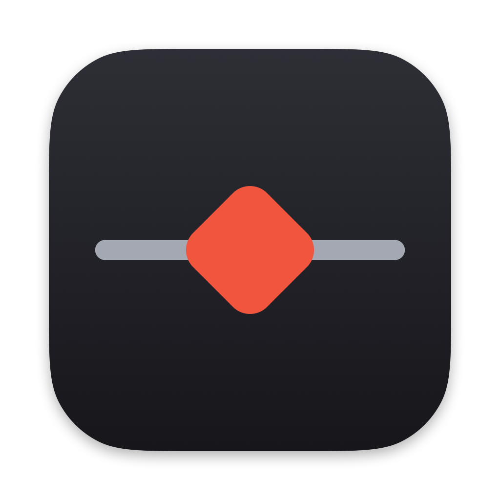
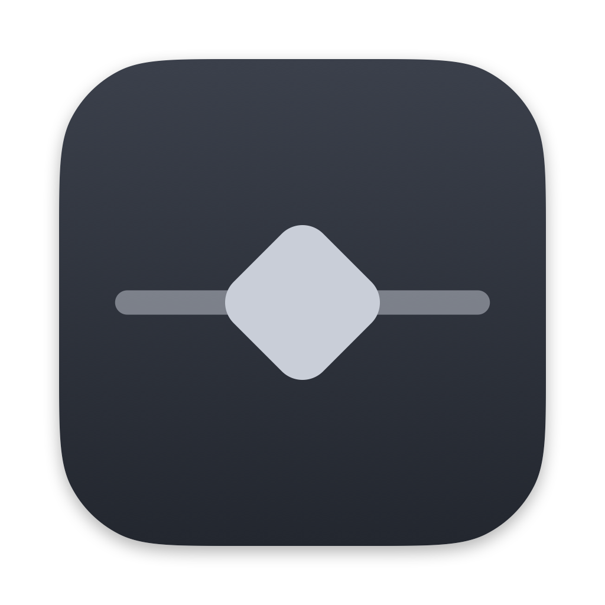

# ProxyWoman 图标说明（设计 4A：菱形落在线上）

<p align="center">
  
  
</p>

左：浅色（默认，已随 App 发布）。右：深色（供 macOS 26 Icon Composer 以后使用，目前不随 App 发布）。

## 1. 产品定位

ProxyWoman 是免费、开源的原生 macOS HTTP/HTTPS 调试代理。核心能力是三件事：**抓、拦、改**——抓下流量、在途中拦住、改完再放行。
图标要在 Dock、Finder 和菜单栏里一眼认出，并且和同类工具明显区分。

## 2. 隐喻

一条横线是网络里的流量。一个数据包沿着线跑，被**停在线上，并被转了一个角度**：它被拦下（拦），被改变（改），而线本身没有断（抓，旁观不干扰）。
所以画面只有两个元素：灰色的线，和压在线上的珊瑚红菱形。没有多余的装饰，也没有光泽和渐变。

## 3. 颜色与避让

- 主色珊瑚红 `#F2553D`，只用在菱形上，是图标里唯一的彩色。
- 要和 Proxyman 的蓝色人物图标、Fiddler 的绿色明显分开。珊瑚红在 Dock 里既不是蓝也不是绿。
- 不使用人物或角色形象。名称 ProxyWoman 已经是 Proxyman 的谐音，《ProxyWoman-产品与技术方案.md》里记录了商标混淆的风险；图标再用人物，会加重混淆。降低风险的做法之一就是图标和配色自己设计，完全不沾 Proxyman 的视觉。
- 底色用近白的冷灰渐变，线用中性灰，让红色成为视觉中心。

## 4. 几何（精确值）

所有坐标在 100×100 的“主体（body）”空间里，主体就是圆角方形的图标本体。

| 元素 | 规格 |
| --- | --- |
| 背景 | 垂直线性渐变，顶 `#FFFFFF` 到底 `#EEF0F4`；1 个单位等效的发丝边框 `#DCDFE6`（1024 画布上约 2 px，画在主体内侧） |
| 线 | 从 (14,50) 到 (86,50)，线宽 5，圆头，颜色 `#A3A8B3` |
| 菱形 | 26×26 的方块，圆角半径 6，中心 (50,50)，旋转 45°，纯色 `#F2553D`，无渐变、无高光 |

macOS Big Sur 之后的图标网格：

- 画布 1024×1024；主体是 824×824，四边各内缩 100 px。
- 主体用连续曲率的圆角（squircle），圆角半径约 185 px（路径用平滑系数 0.6 的两段三次贝塞尔拼成）。
- 主体下方有柔和投影：向下偏移 10 px，模糊 28 px，黑色 30%。其他尺寸按画布比例缩放。
- 1 个主体单位在 1024 画布上约 8.24 px。

## 5. 变体

| 变体 | 背景 | 线 | 菱形 | 文件 |
| --- | --- | --- | --- | --- |
| 浅色（默认） | `#FFFFFF` 到 `#EEF0F4`，边框 `#DCDFE6` | `#A3A8B3` | `#F2553D` | `appicon-light-1024.png`，已编进 `AppIcon.icns` |
| 深色 | `#2E2E36` 到 `#16161B`，无边框 | `#A3A8B3` | `#F2553D` | `appicon-dark-1024.png` |
| 着色（tinted） | `#3B404B` 到 `#23272F` | `#C9CED8`，50% 不透明 | `#C9CED8` | `appicon-tinted-1024.png` |




macOS 26 的 Icon Composer 以后要用分层素材：`layer-background.png`（背景）、`layer-line.png`（线）、`layer-diamond.png`（菱形）。三张都是 1024×1024 透明底，元素按上面的主体网格摆好，叠在一起就是浅色图标（不含边框和投影，这两样由系统给）。深色和着色版用上表的颜色在 Icon Composer 里对同样三层换色即可。

菜单栏图标是单独的模板图：`menubar-diamond.png`（18×18）和 `menubar-diamond@2x.png`（36×36）。只有 alpha 通道，黑色菱形压在一条短线上，菱形四周留出约 1 pt 的缝，让线看起来是被它截停的。App 里按 NSImage template 加载，系统会自动按浅色和深色菜单栏着色。

## 6. 最小尺寸规则

- 16 px 和 32 px（含 `@2x` 里的 32 px）：不画投影；主体边界对齐整像素；线至少 1 px；菱形中心对齐像素，边缘保持清晰。
- 64 px 及以上：完整渲染，投影按比例缩放。
- 16 px 下菱形只有约 4 px 宽，看起来会像一个小十字，这是预期内的，不要为它另画一套图形。
- 菜单栏图标不要小于 18 pt 的设计尺寸。

## 7. 该做和不该做

该做：

- 只用上面的颜色和几何，需要别的尺寸时重新运行脚本，不要手工缩放 PNG。
- 保持红色菱形是唯一的彩色。
- 在白色、深色、壁纸背景上都检查一遍。

不该做：

- 不要加人物、脸、爪子、字母、盾牌、锁、放大镜等常见的“代理”符号。
- 不要给菱形加渐变、高光、描边或内阴影。
- 不要把线画成断开的、虚线的或带箭头的。
- 不要把菱形换成蓝色或绿色，也不要出现 Proxyman 或 Fiddler 的标志和配色。
- 不要在图标里放文字。
- 不要手工修改 `App/Resources` 和 `docs/brand` 里的生成文件，改脚本再重新生成。

## 8. 生成方式

```
scripts/icon/make-icons.sh
```

- `scripts/icon/render-icon.swift`：只用 CoreGraphics 渲染 `AppIcon.iconset` 和 `brand/` 下的 PNG。
- `make-icons.sh`：用 `iconutil` 生成 `App/Resources/AppIcon.icns`，把品牌 PNG 复制到 `docs/brand/`，菜单栏 PNG 复制到 `App/Resources/`。生成结果已提交，构建时不用重新生成。
- `scripts/build-app.sh` 把 `AppIcon.icns` 和菜单栏 PNG 放进 `ProxyWoman.app/Contents/Resources/`，并在 `Info.plist` 里写入 `CFBundleIconFile = AppIcon`。
